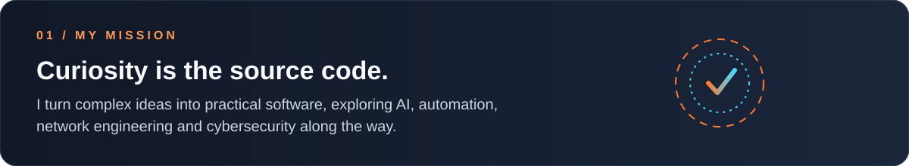
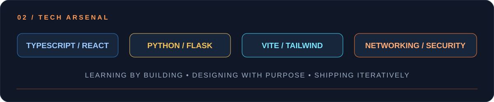
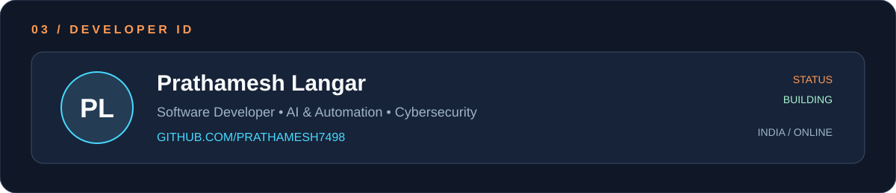

 

  

  

  

## ⚡ S-Rank Projects

<table>
<tr><th>Project</th><th>Mission briefing</th><th>Focus</th></tr>
<tr><td><a href="https://github.com/Prathamesh7498/NetScope"><b>NetScope</b></a></td><td>Network traffic analysis, packet inspection, protocol decoding, flow analysis and anomaly detection.</td><td>Networking · Python · React</td></tr>
<tr><td><a href="https://github.com/Prathamesh7498/Friday-"><b>Friday</b></a></td><td>Local-first personal AI assistant concept across web, mobile and API, designed around privacy and security.</td><td>AI · Architecture · Security</td></tr>
<tr><td><a href="https://github.com/Prathamesh7498/OpenJarvis"><b>OpenJarvis</b></a></td><td>Exploring the OpenJarvis personal-AI ecosystem and on-device AI ideas. See repository for upstream project context.</td><td>Personal AI · On-device AI</td></tr>
<tr><td><a href="https://github.com/Prathamesh7498/portfolio"><b>Developer Portfolio</b></a></td><td>Portfolio website project to present selected work, skills and progress.</td><td>Web · UI · UX</td></tr>
</table>

<a href="https://github.com/Prathamesh7498?tab=repositories"><b>→ Explore all my repositories</b></a>

  

## 🌌 Contribution energy

*Every commit is another step forward.*

  

  

  

**Understand. Explore. Create.** ⚡

Thanks for visiting my profile — keep learning, keep building.

