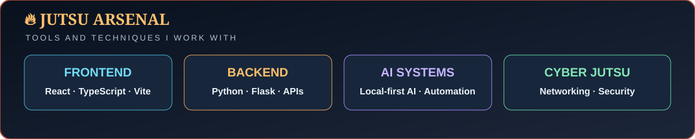
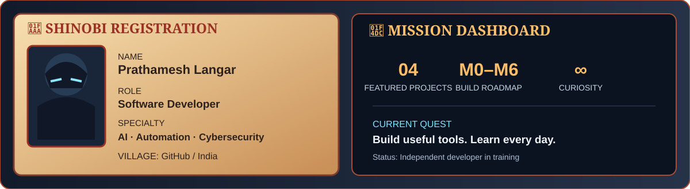
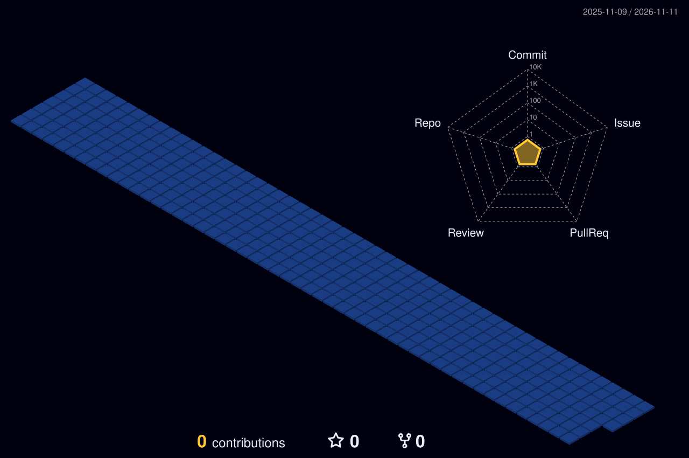

  

  

  

  

  

## 🍥 S-Rank Missions

| Mission | What it is | Jutsu used |
|---|---|---|
| [**NetScope**](https://github.com/Prathamesh7498/NetScope) | Network traffic analysis project for packet inspection, protocol decoding, flow analysis and rule-based anomaly detection. | Python · React · TypeScript |
| [**Friday**](https://github.com/Prathamesh7498/Friday-) | Local-first personal AI assistant planned across web, mobile and API, with privacy and security as core design principles. | AI · Architecture · Security |
| [**OpenJarvis**](https://github.com/Prathamesh7498/OpenJarvis) | Exploring the OpenJarvis personal-AI ecosystem and on-device AI ideas. See repository for upstream project context. | Personal AI · On-device AI |
| [**Portfolio**](https://github.com/Prathamesh7498/portfolio) | Developer portfolio website project for presenting selected work, skills and progress. | Web · UI · UX |

<a href="https://github.com/Prathamesh7498?tab=repositories"><b>→ Explore all my repositories</b></a>

  

### 🌃 My contribution village

*Every commit helps the village grow — generated automatically.*

  

  

  

  

**Dattebayo — keep coding, keep growing.** 🍥

