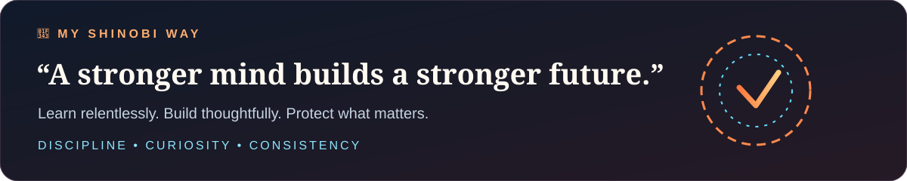
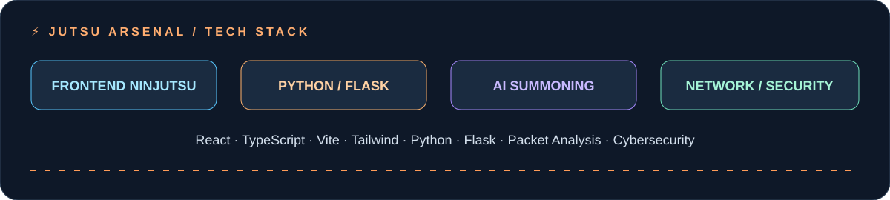
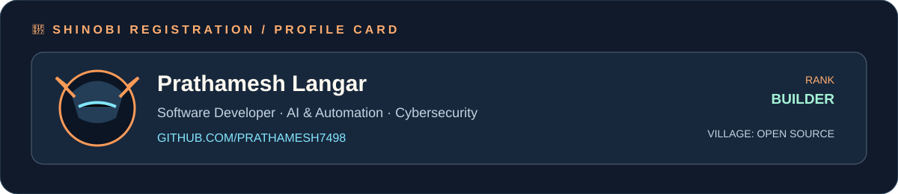

 

  

  

  

## 🍥 S-Rank Missions

<table>
<tr><th>Mission</th><th>Mission briefing</th><th>Jutsu / focus</th></tr>
<tr><td><a href="https://github.com/Prathamesh7498/NetScope"><b>NetScope</b></a></td><td>Network traffic analysis: packet inspection, protocol decoding, flow analysis and rule-based anomaly detection.</td><td>Networking · Python · React</td></tr>
<tr><td><a href="https://github.com/Prathamesh7498/Friday-"><b>Friday</b></a></td><td>Local-first personal AI assistant concept across web, mobile and API, designed around privacy and security.</td><td>AI · Architecture · Security</td></tr>
<tr><td><a href="https://github.com/Prathamesh7498/OpenJarvis"><b>OpenJarvis</b></a></td><td>Exploring the OpenJarvis personal-AI ecosystem and on-device AI ideas. See the repository for upstream project context.</td><td>Personal AI · On-device AI</td></tr>
<tr><td><a href="https://github.com/Prathamesh7498/portfolio"><b>Portfolio</b></a></td><td>Developer portfolio website project for presenting selected work and skills.</td><td>Web · UI · UX</td></tr>
</table>

> Mission status describes current project scope; planned features are not claimed as shipped.

<a href="https://github.com/Prathamesh7498?tab=repositories"><b>→ Explore all missions / repositories</b></a>

  

## 🏯 The contribution village

*Every contribution helps the village grow.*

  

  

  

**“Train. Build. Improve. Repeat.”** 🍃

Thanks for visiting my shinobi headquarters.

